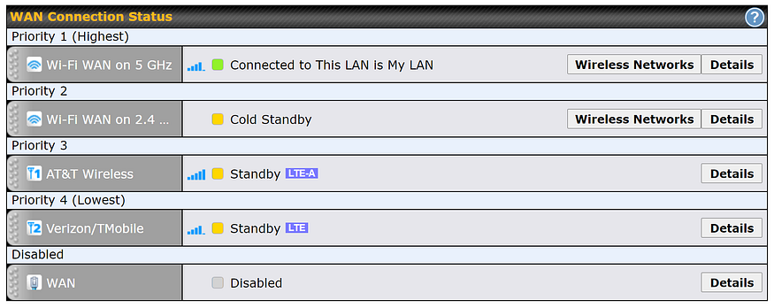
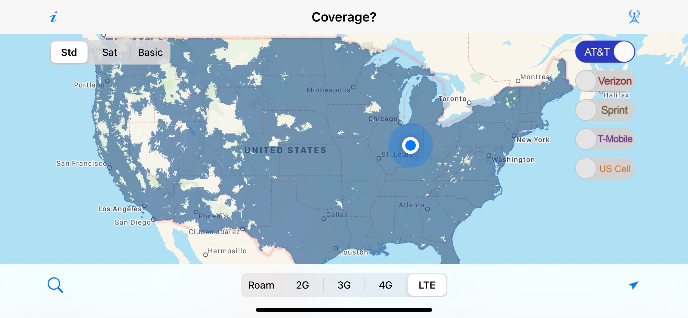
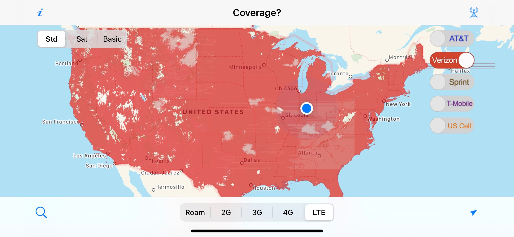
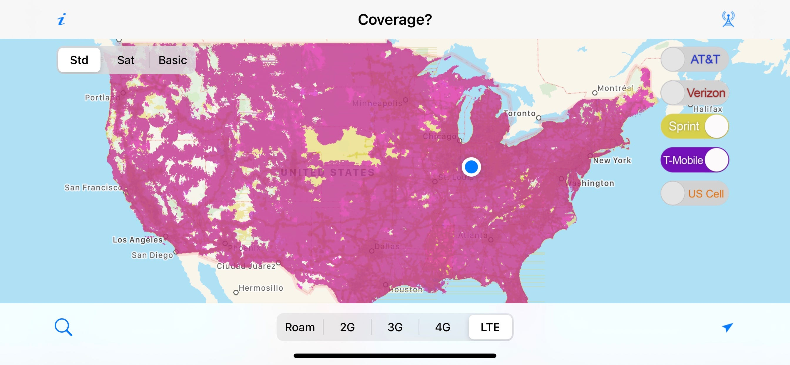
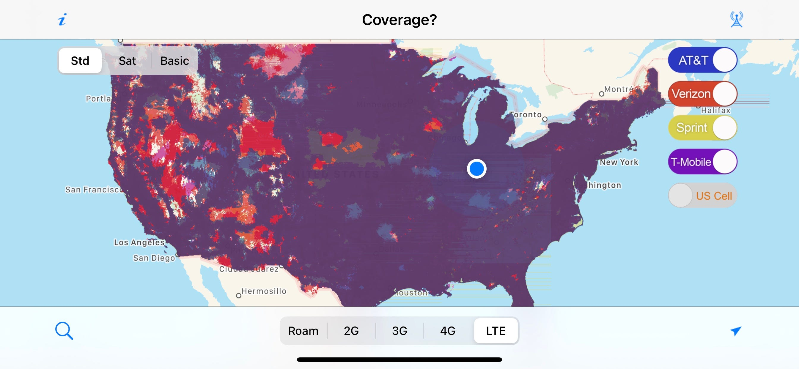

*Disclaimer: You probably shouldn’t do it this way. This way of getting Internet on the road is complicated, expensive, and genuinely overkill even for my needs. For more information on what reasonable solutions look like, I recommend (and am a member of) the [Mobile Internet Resource Center](https://www.rvmobileinternet.com/).*

One of the things that is most frustrating to me when travelling is trying to get a usable Internet connection. I do nearly everything online. Socialize, work, and entertain myself just to name a few. Also, between my work and volunteering I typically want/need to know when and where I’ll have connections that can do different things.

I’ve tried several solutions over the years from travel routers to portable hotspots, and none of them really was able to do what I needed all the time. This summer when I started really thinking about and working on what the van build was going to entail, I knew that things were just going to be harder. Staying in the van means no hotel Wi-Fi, which… while inconsistent is almost always enough for email and voice. My experience in parks and on the road also show that you can’t rely on any single cell provider to have signal and usable speeds everywhere. I knew I wanted to have every opportunity to get good Internet wherever I was, so I knew I needed the ultimate solution.

After tireless research, I decided the Peplink Max Transit Duo CAT-12 router would be the best core for my mobile network. This router, while expensive, gives me the ultimate flexibility and provides a stable platform to build from. I knew I wanted to be able to select from whatever was available to me — campground Wi-Fi, LTE, or even a wired connection. On top of that, the Peplink devices let me load balance and bond connections when a single connection isn’t able to support my needs.

My complete system consists of:

- Peplink Max Transit Duo (Cat 12)
- Peplink AP One AX Access Point
- Poynting 7-in-1 Roof Mounted Antenna with Magnet Mount Kit
- Unlimited Data LTE SIMs from AT&T, Verizon and T-Mobile

*My default “underway” configuration*

As you can see from the screenshot above, by default I don’t load balance or bond connections. This is because due to how Peplink does their link management, balancing between connections that are different or changing performance tends to result in a usable bandwidth of the slowest connection. Once I stop for a while, I can click a few buttons and figure out if it’s worth it to aggregate, load balance or change priorities to get a better connection — but it will always have one if there’s one to be had.

So, then, why even have a dual-radio device? It only takes about a minute to switch SIMs and many of the Peplink devices can do it automatically. But what a dual-sim solution can’t do is be smart about when to switch when a carrier is *active*. My experience in my travels has been that AT&T *tends* to be quite fast and have good coverage, and when TMobile has signal it tends to also be fast. But nobody has coverage everywhere. I had an entire driving day on my last big trip where Verizon was the only game in towns. This setup will connect me in preference order to the carrier that’s up and working at any given time and location without me having to do anything or wait on things to percolate. And when it makes sense, I can use more than one network for more bandwidth.

Ok, so what about SpeedFusion, I bet you use that all the time! Nope. Unless I’m doing something that’s sensitive to connection loss (like Zoom) or I’m in a really dynamic signal situation it’s generally not worth the 20+% performance penalty. And when I’m static I’ve only found it important when my individual connection speed is <5mbps.

So, all this fanciness and most of the time it’s a glorified jetpack? Yeah, so remember how I said at the beginning you probably shouldn’t do it this way? That’s why. Most of the time it’s not helpful at all. If you do find yourself travelling outside your main carrier’s coverage just set your phone up with another SIM. Or like, it’s OK to be offline for a while. If you’re worried about safety when off the grid, try an InReach or Spot satellite device.

*Originally published in OverVANalyzed on [Medium](https://medium.com/overvanalyzed/wan-on-the-run-94f7564efdfb).*
