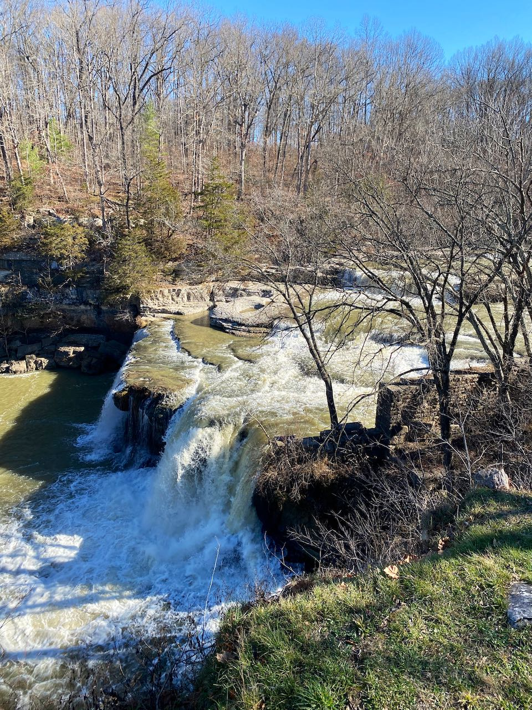
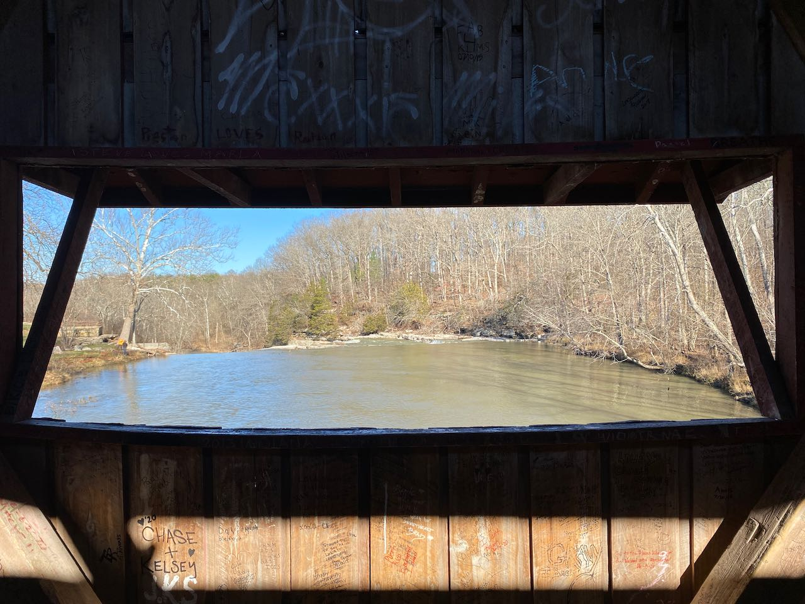
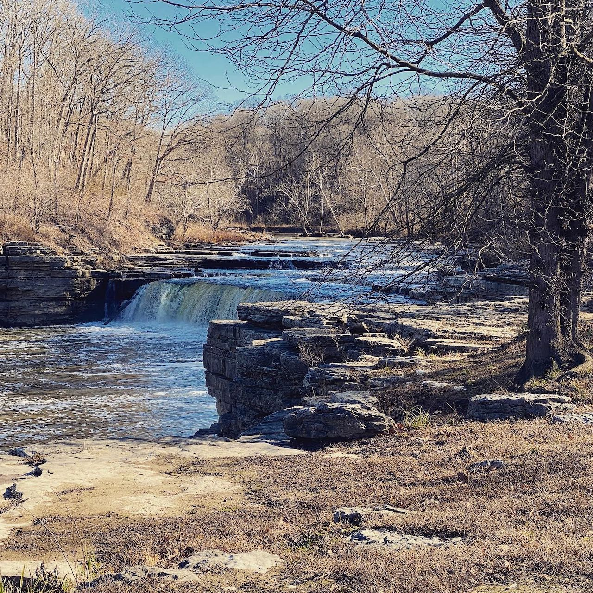
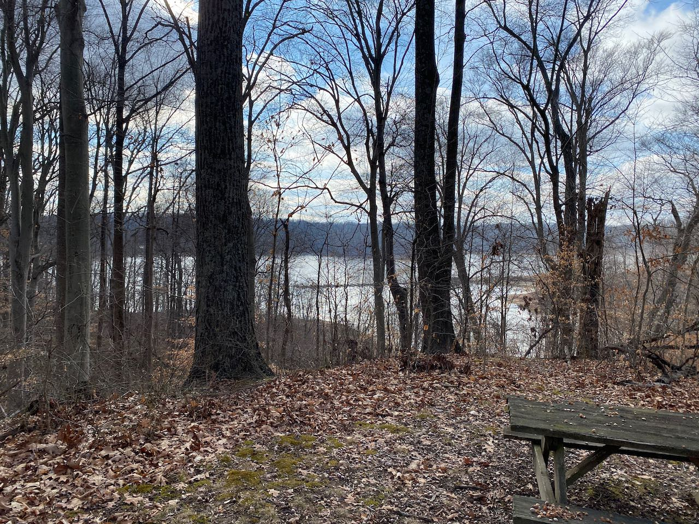

Cataract Falls and Lieber SRA make up the [Cagles Mill
Lake](https://www.in.gov/dnr/state-parks/parks-lakes/cagles-mill-lake-lieber-and-cataract-falls-sra/)
property. This is a pretty gorgeous place to visit though fairly short on
trails. Excellent picnicking and family activities though. I hiked the nature
trail at Cataract Falls with my mom, and enjoyed a picnic by the
lake.

