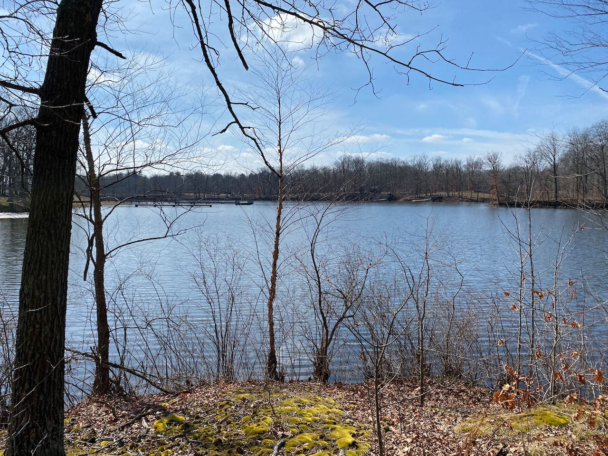
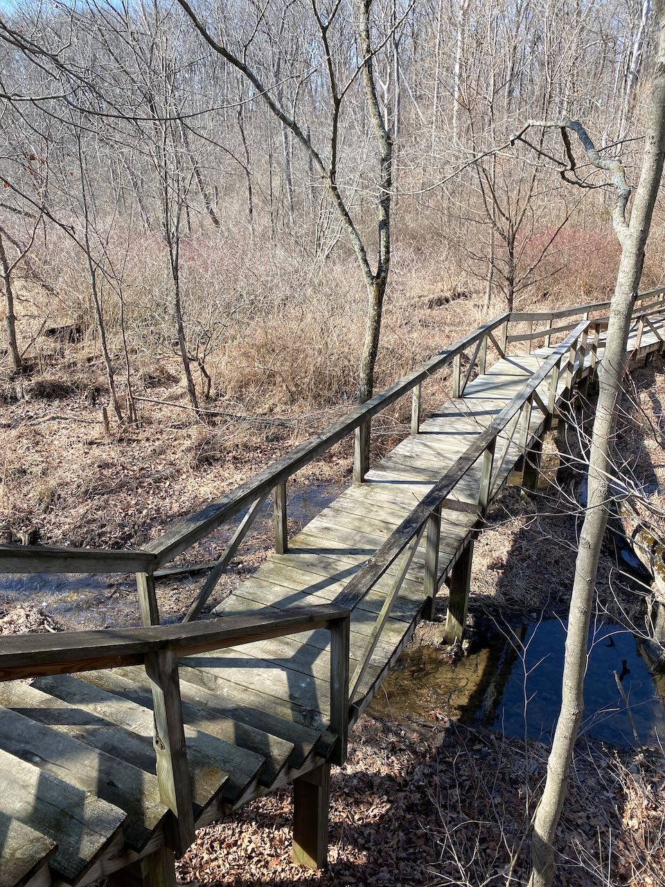
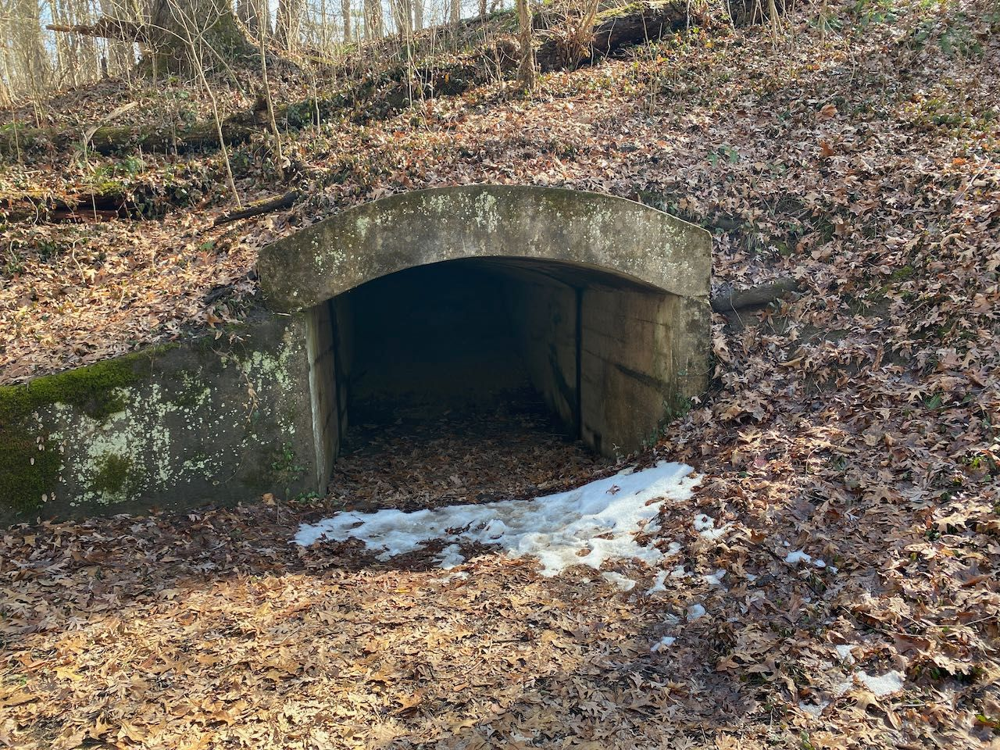
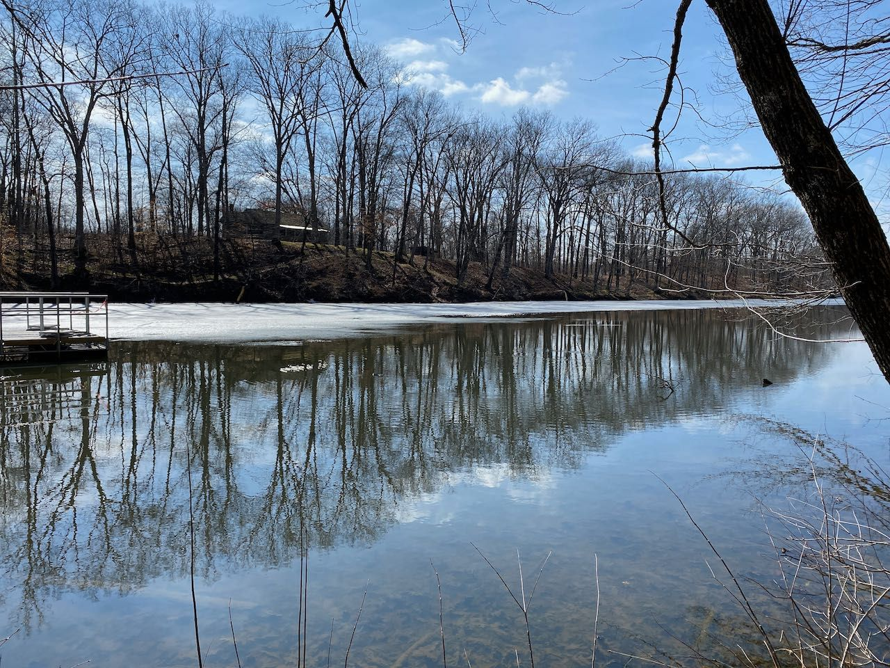

[Shakamak](https://www.in.gov/dnr/state-parks/parks-lakes/shakamak-state-park/)
offers some great trails and some pretty great looking family cabins. While I
visited, I hiked trails 2 and 3. This park includes some great amenities, and is
very well kept. Highly recommended!
