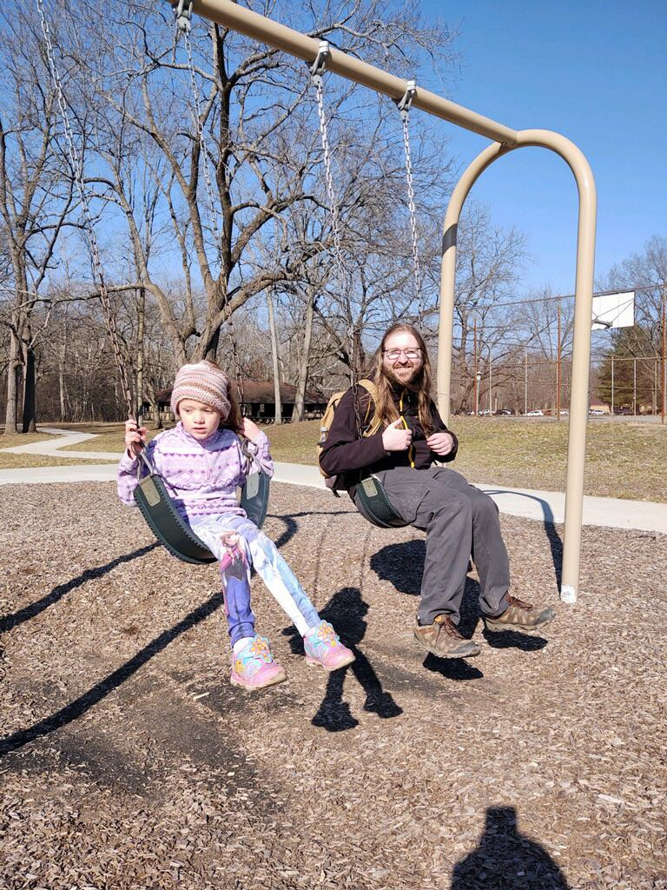

[Turkey Run](https://www.in.gov/dnr/state-parks/parks-lakes/turkey-run-state-park/) is a pretty famous park,
so when an opportunity to go hike it early in the season when it wasn't going to
be too busy came by I had to jump. I was lucky enough to be joined by my niece
and, I guess my brother and sister-in law came too...

Once we wrapped up I swung by [Racoon
Lake](https://www.in.gov/dnr/state-parks/parks-lakes/cecil-m-harden-lake-raccoon-sra/) to enjoy a picnic by the lake
before driving home.
