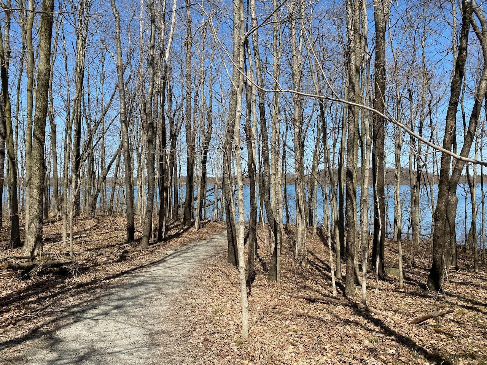
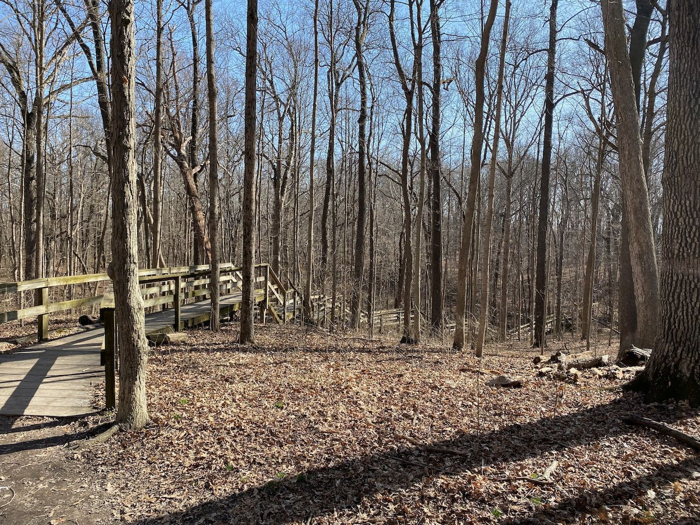
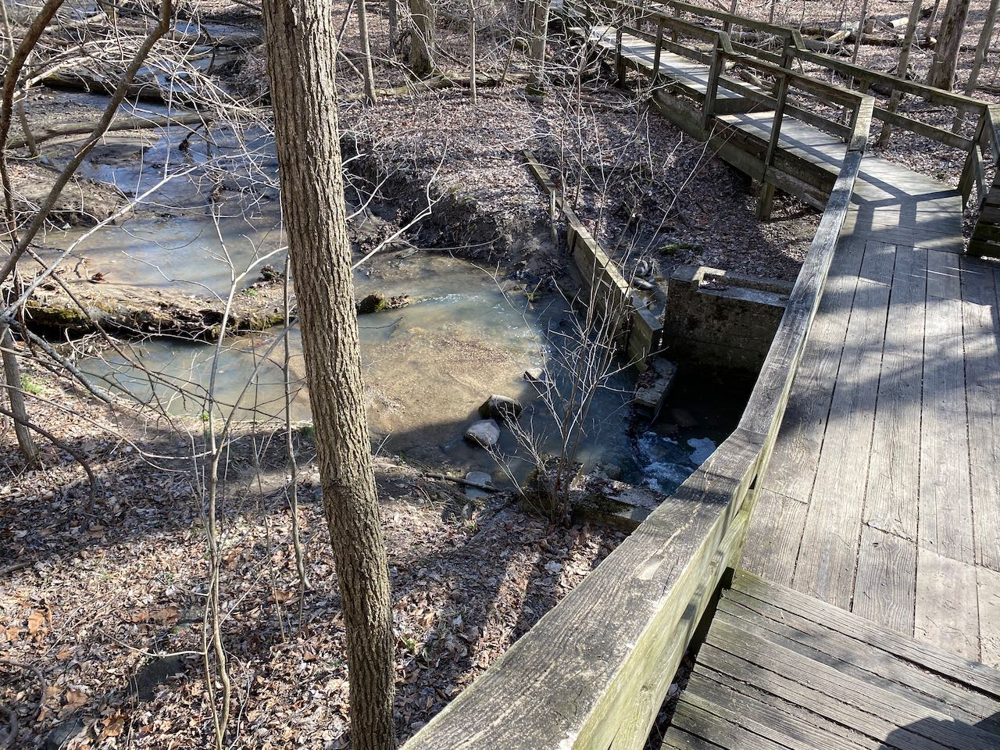

Finally, a break in the weather again! I chose Summit Lake because it was
advertised as having hard-packed trails and we'd just had a super rainy spell,
and it was a perfect fit for the day.

Trail 3 at Summit Lake is a nice gentle trail along the lakeshore with plenty of
 twists and turns so you could do it several times and not go exactly the same
 way each time. Its trailhead is conveniently located next to some great picnic
 facilities as well, so take advantage of that while you're there. I then did a
 hybrid of trails 1 and 5 before heading off to Mounds for a dinner picnic and a
 short hike of parts of trails 4 and 5.

Both parks were well maintained and had great facilities.
