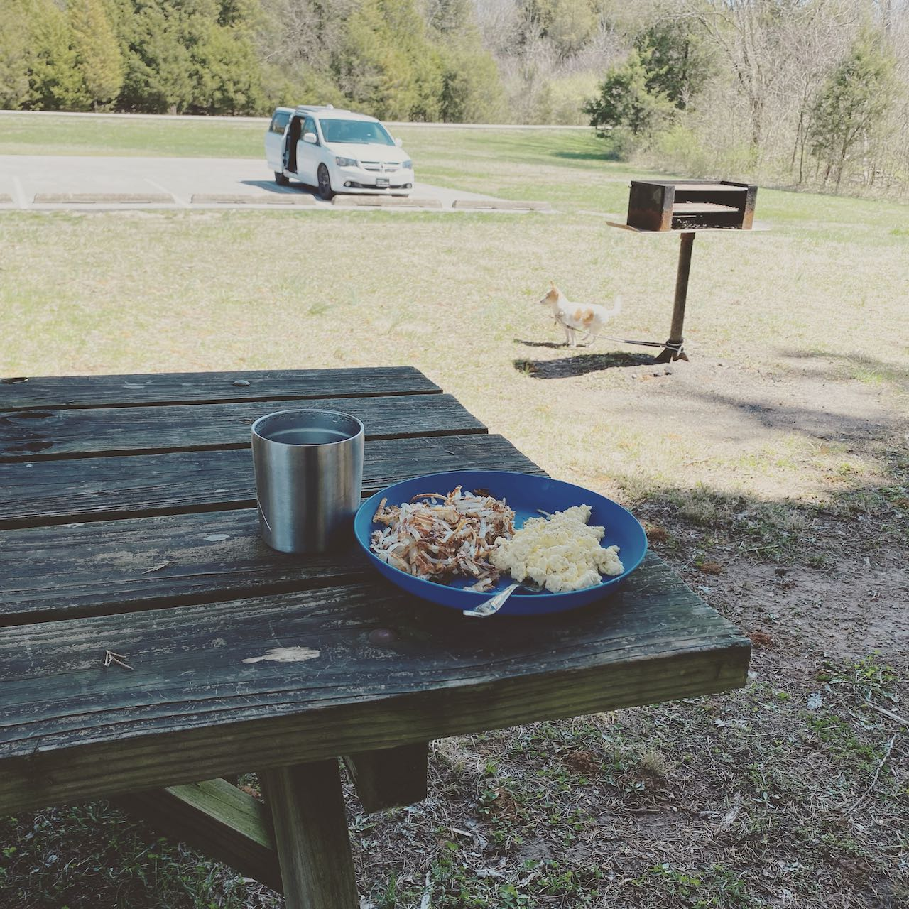

This trip I took my dog with me, and I have to say. Charlestown is an excellent
park with some very good moderately technical trails. Normally, I'd like to
cover a little more distance but doggo really seems pretty tired so we'll call
it good.

I did take the
opportunity to try out some [crystalized eggs](https://amzn.to/2PV1QFW), and...
they were pretty good. And, of course my favorite cheap frozen hash browns.
