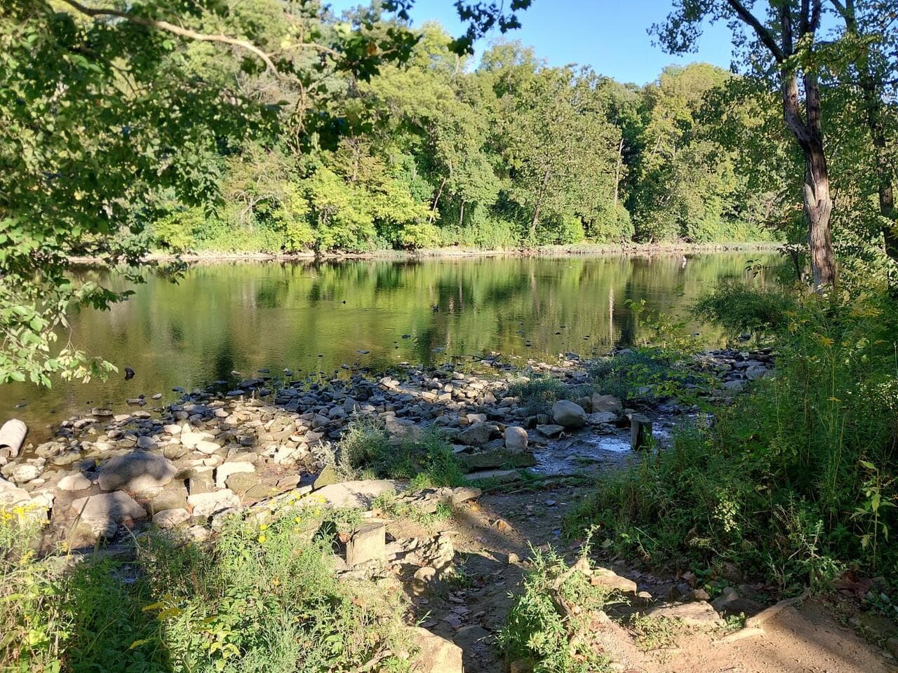
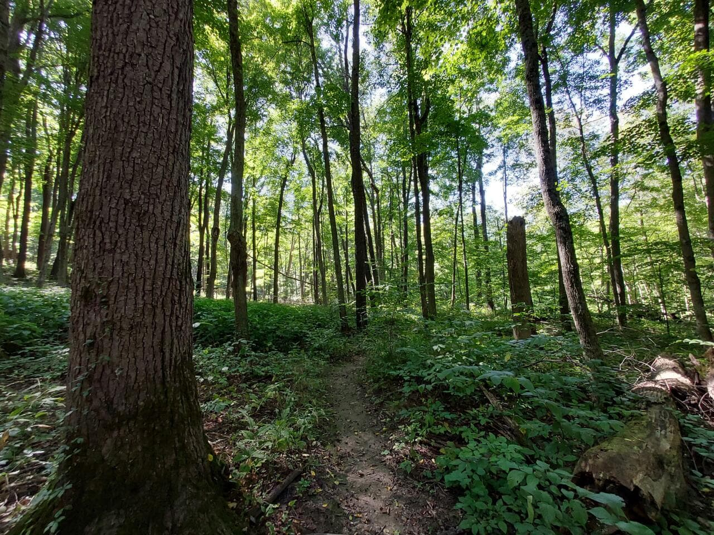
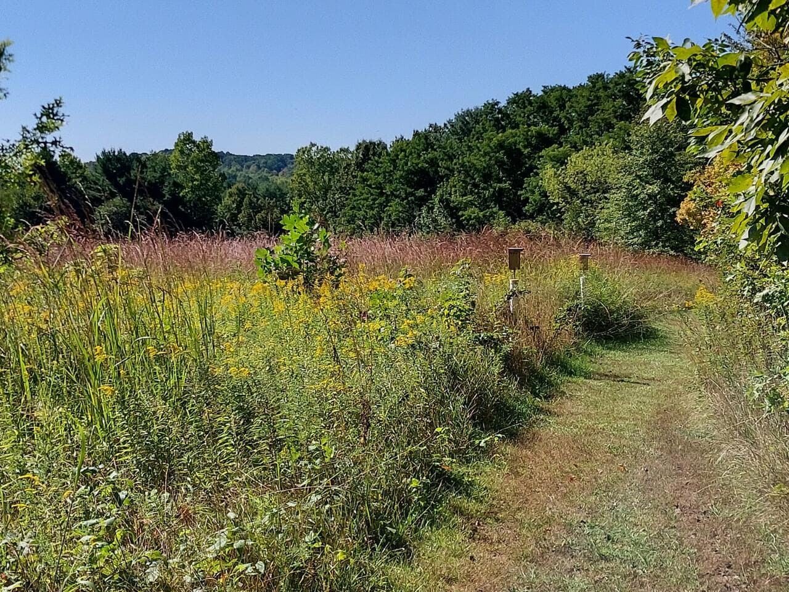
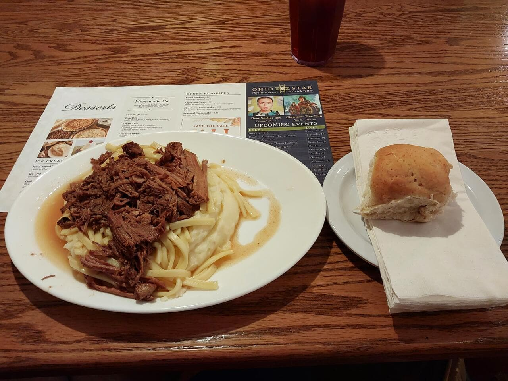
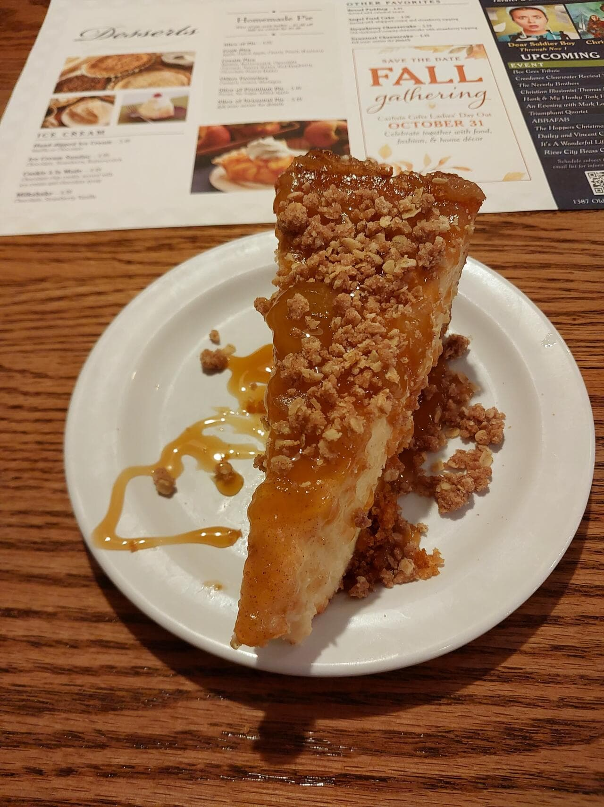
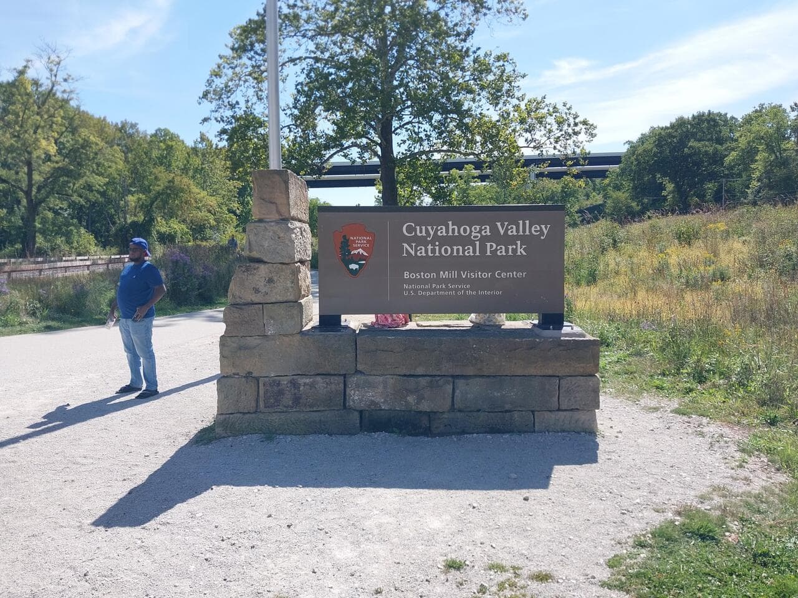
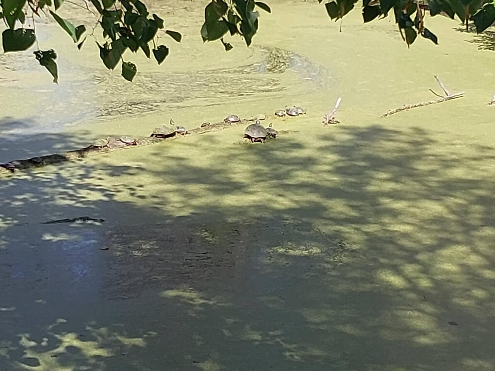
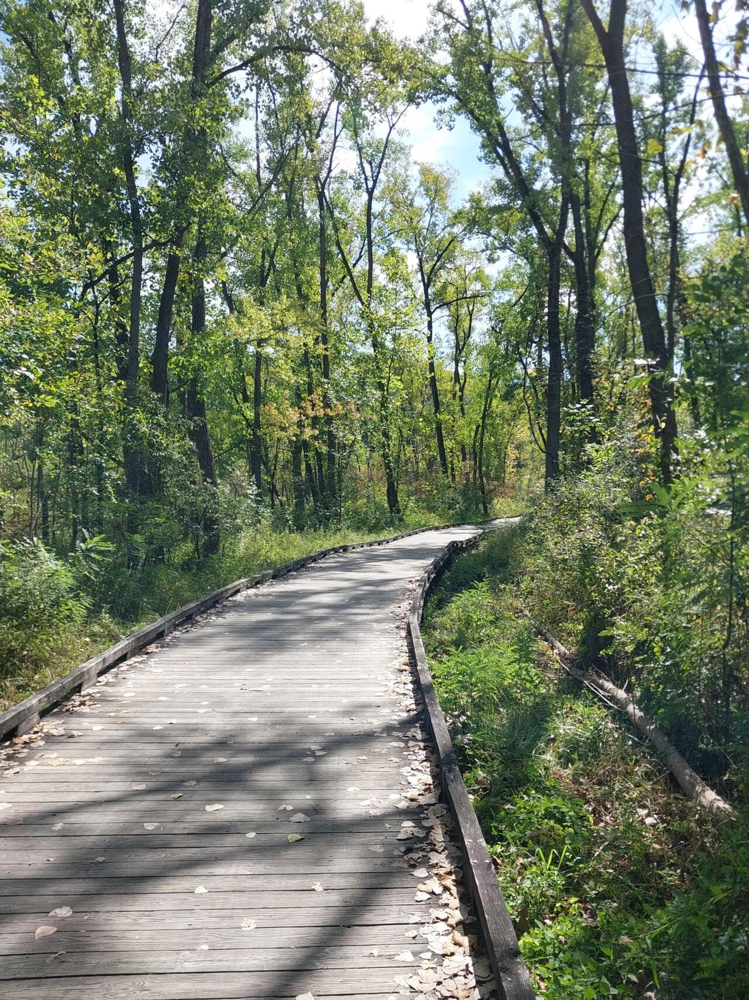
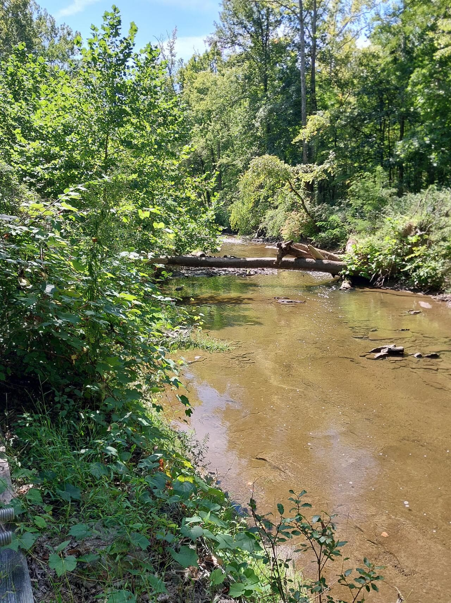

It’s been an adventure all its own to kick off this season of travel. I gave up my
apartment as part of the kickoff, which required a lengthy and complex move of
everything into storage. On top of that, in the middle of the move I had to take
the RV back to the factory to get some long delayed repairs made.

Thankfully, with the help of my family and friends, I was able to get everything
going and into good shape and it’s time to begin my travels.

The first leg of travel in this season is to the New England area, because I haven’t
had a chance to spend time in that part of the country before and September / October 
are great times to see the foliage. Normally, I’d try to have an itinerary map to 
start off a segment, but between some technical issues and some very off the cuff 
planning I don’t really have a great one to share.

The general goal right now is to make my camping reservation at Acadia National Park 
on the 24th of September, and after that I’ll be able to more or less bop around as 
I won’t be on such a tight deadline.

Today, I’m enjoying the sound of rain on the metal roof in Pownal, VT at the lovely 
[Pine Hollow Campground](https://www.pinehollowcamping.com/) after spending the weekend 
ripping across New York and Ohio. Tomorrow I’ll move on to Quechee State Park to hike 
the Quechee Gorge Trail and Wednesday I’ll be heading to Shelborne, NH to finish out 
the work week.

And now, for some photos from the trip so far…

## Scioto Park, Dublin, Ohio

## Gorman Nature Center, Mansfield, Ohio

## Der Dutchman, Bellville, Ohio

## Cuyahoga Valley National Park

