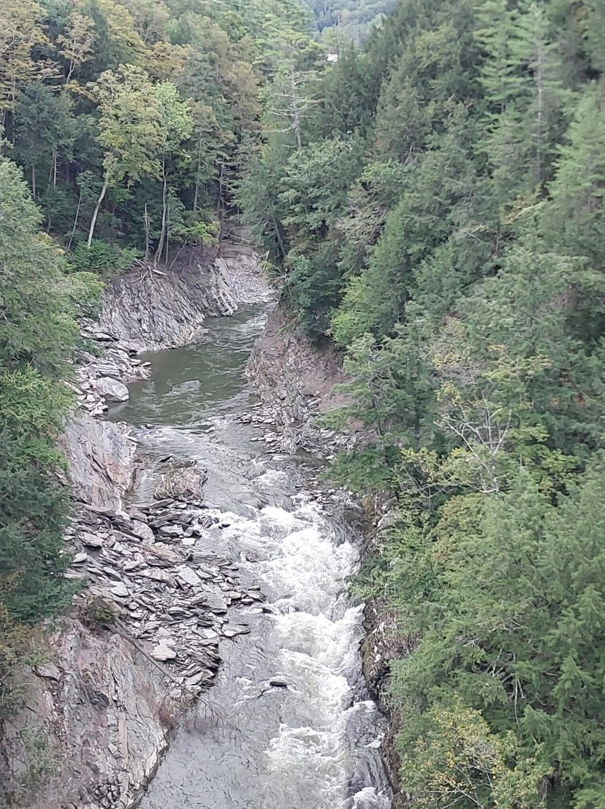
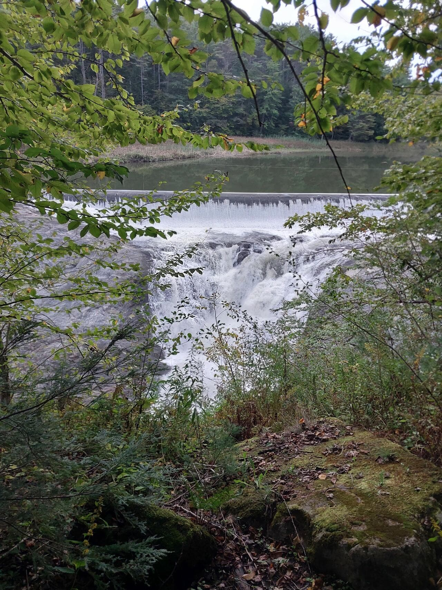
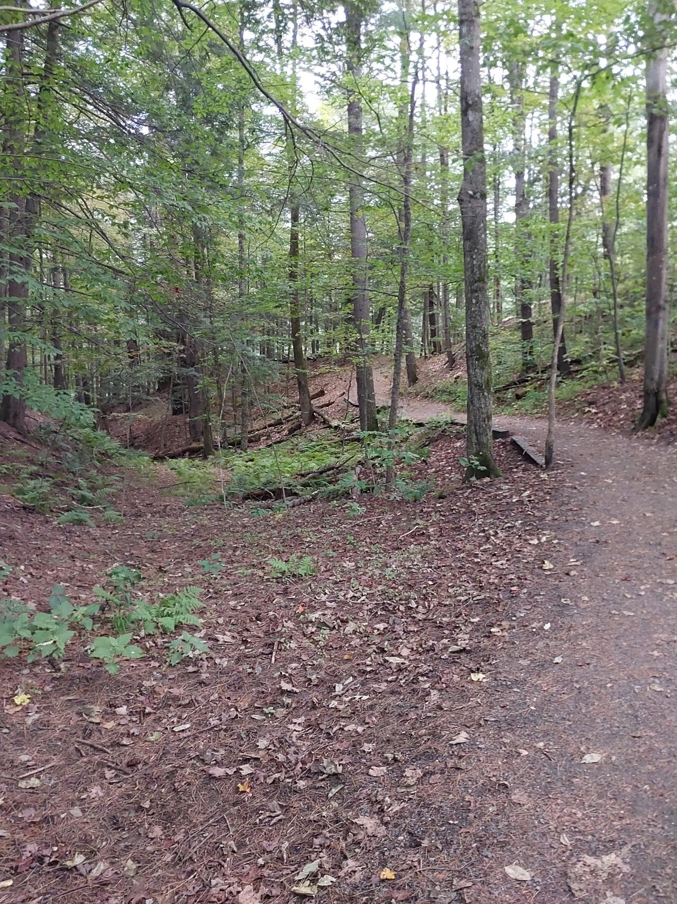
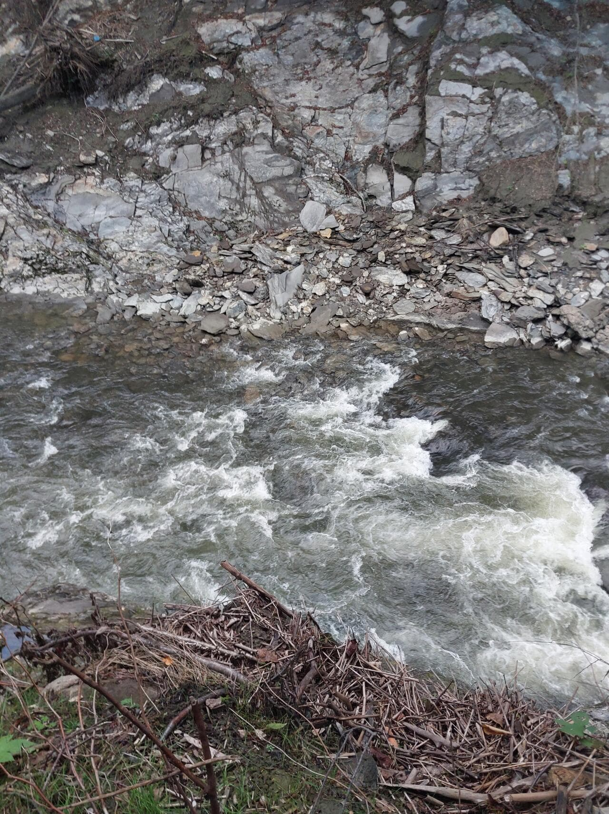
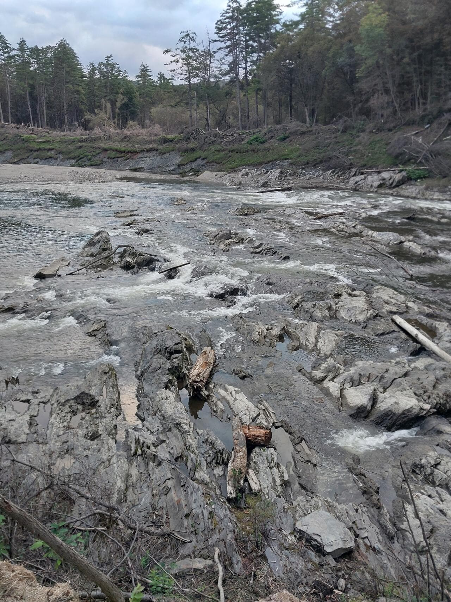

If you google for things to do along I-91 in Vermont, one of the top things on the 
list will inevitably be Quechee Gorge Trail. The state park made for a convenient 
and affordable stop for the night, with direct access to the trail and easy access 
to the shops nearby. Heads up though, the trail from the campground down is pretty 
serious so if you aren’t a big hiker take the shortcut out to the road and join the 
trail at the bridge where things are much easier.

