Honestly, what can I say that hasn’t already been said about Acadia? It was absolutely gorgeous, 
and picking just a few hikes to fit in the time I had was quite the challenge. If you have the
opportunity, definitely go visit!

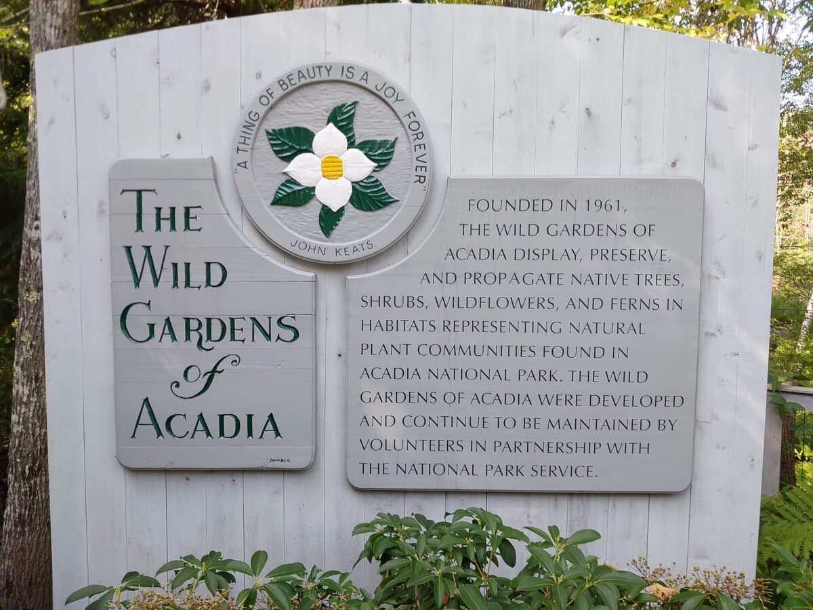
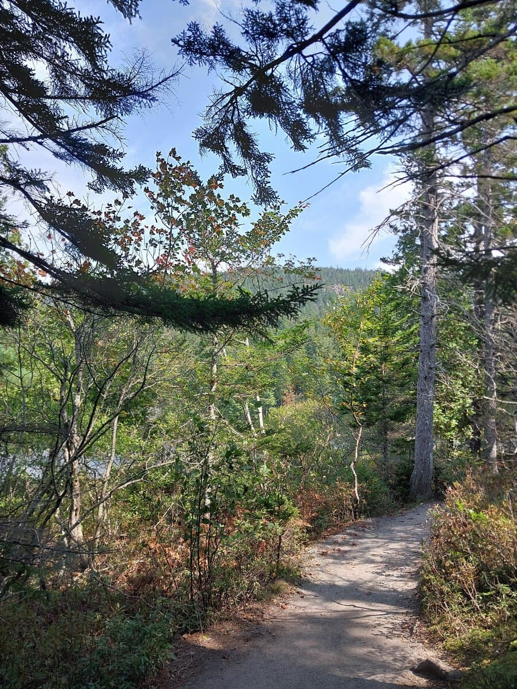
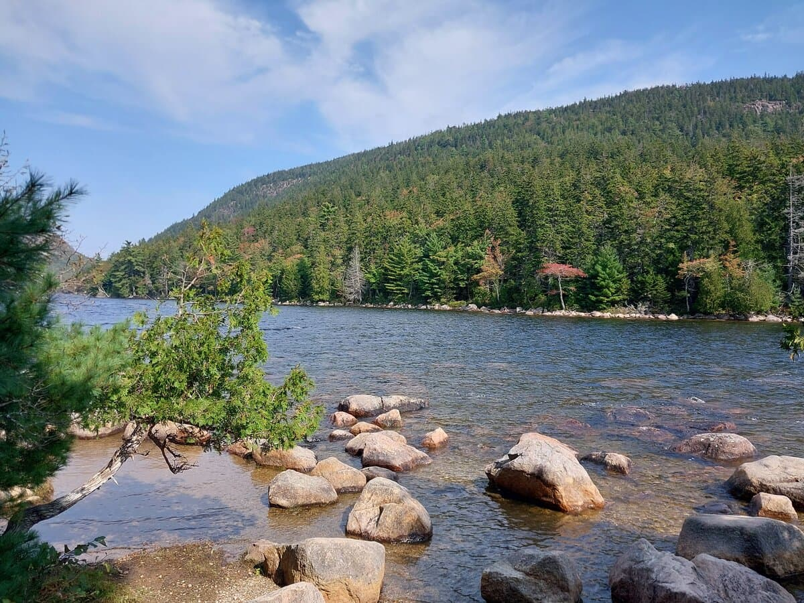
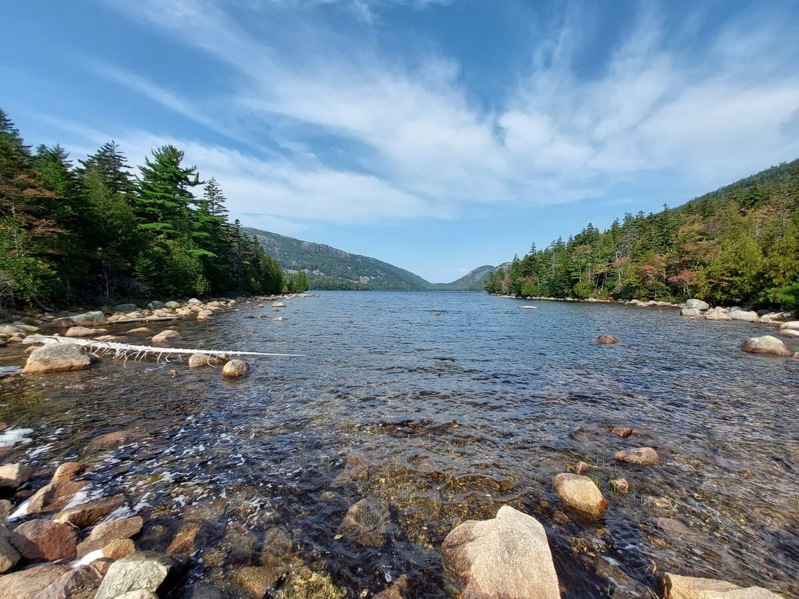
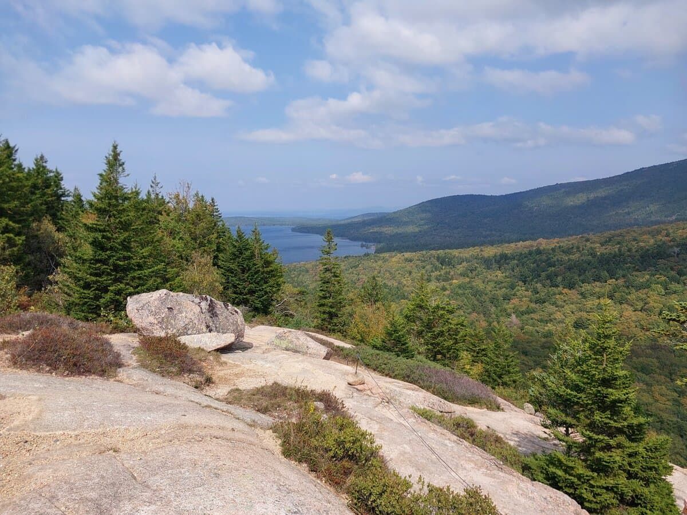
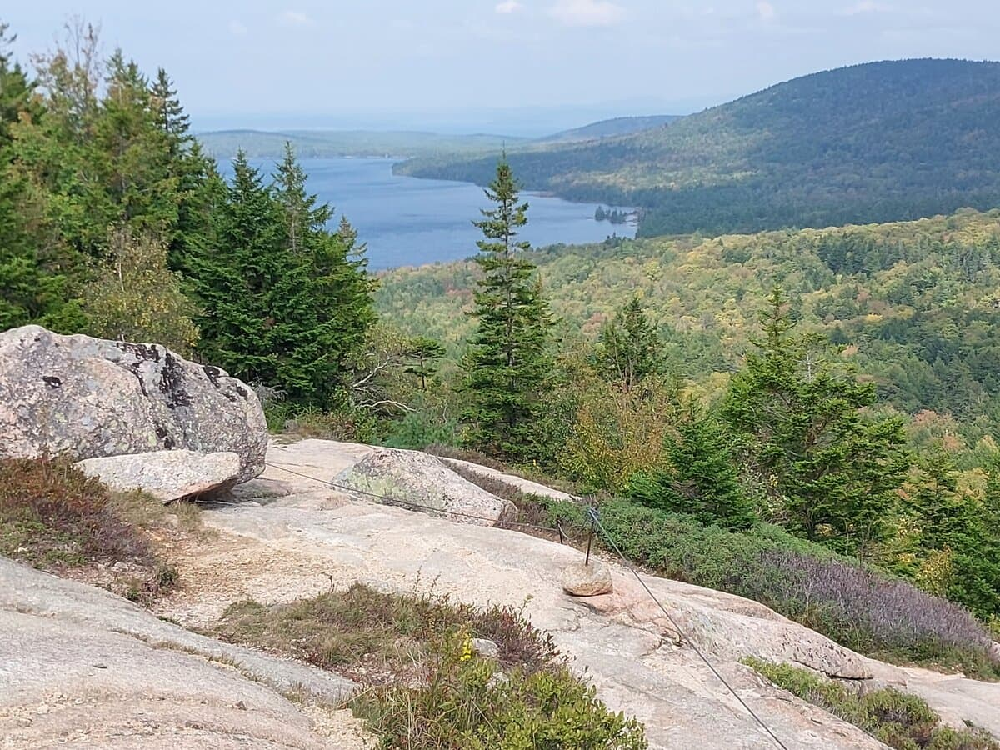
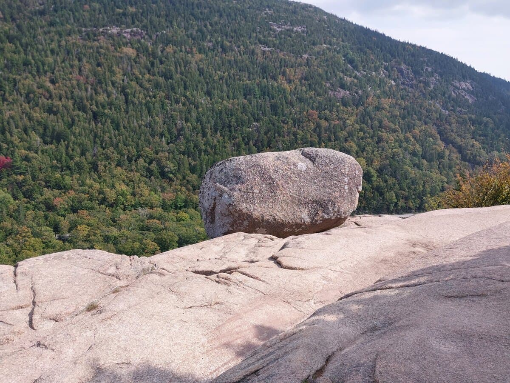
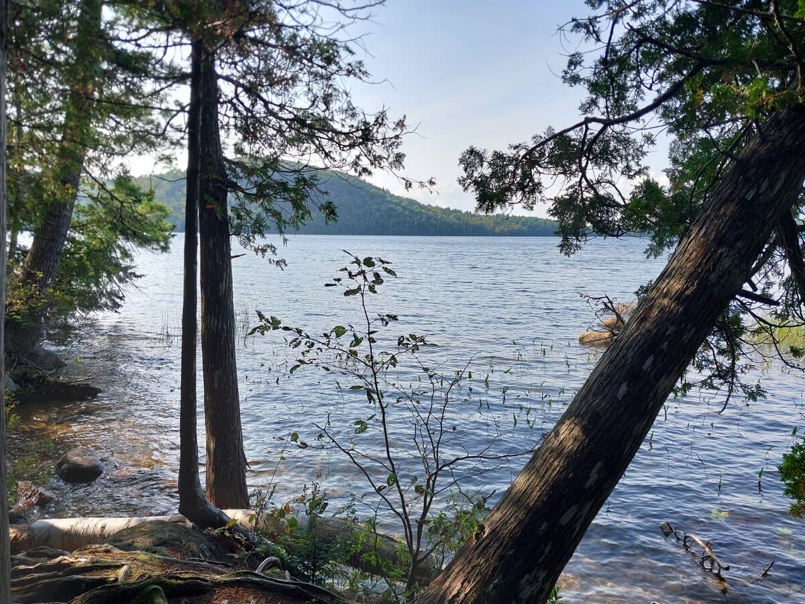
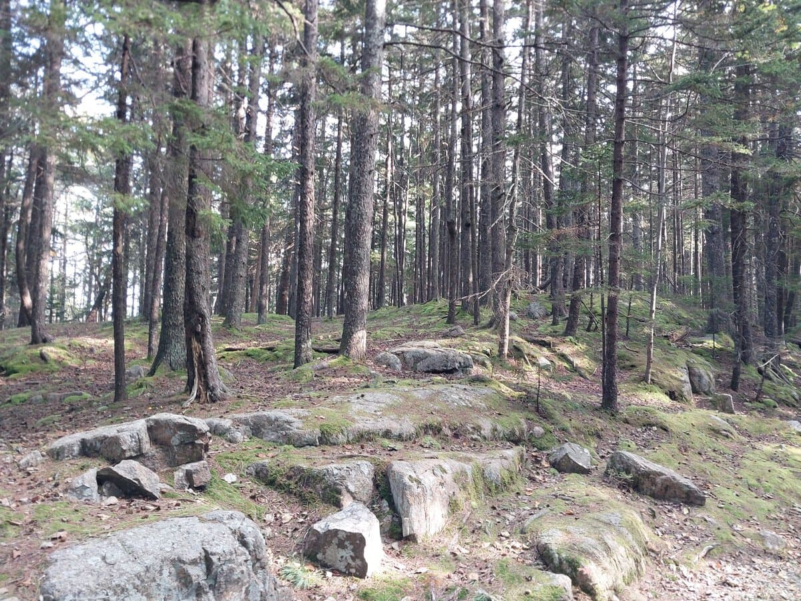
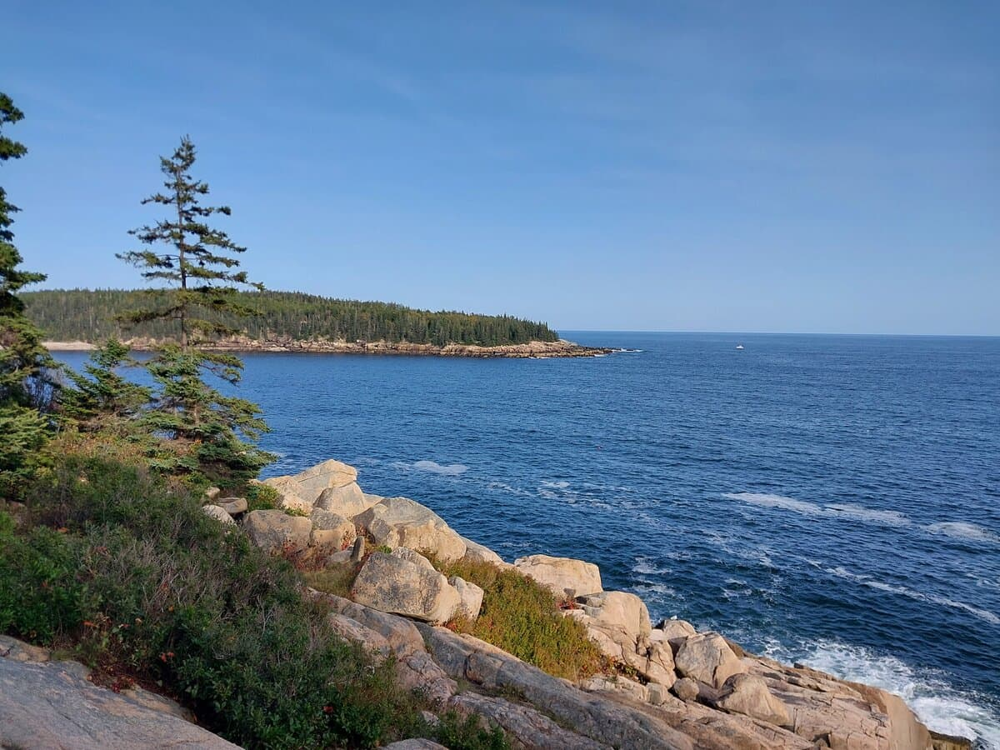
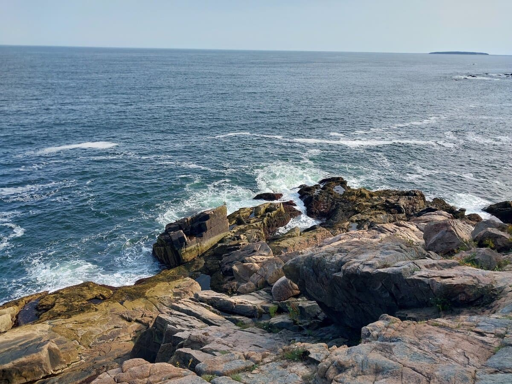
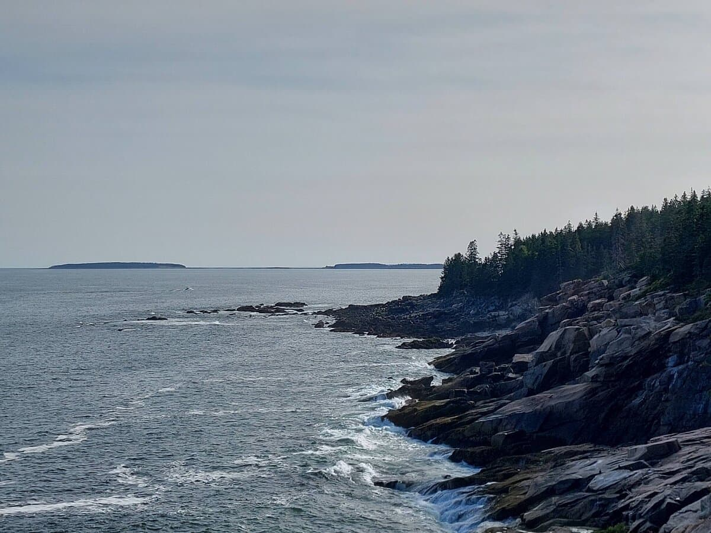
